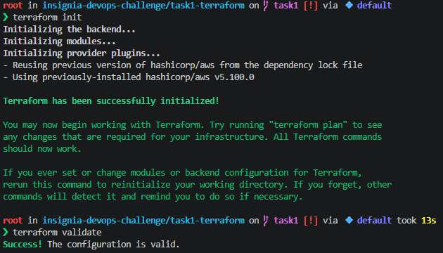

## Task 1 — Terraform
Update variables in main.tf with different format, because failed when tf init
### 1a: NACL Fixes
Add variable `nacl_allowed_cidrs` in nacl.tf (Helper variable for app cidr, protected cidr and pod cidr)
Edit `aws_network_acl_rule` for:
- `protected_inbound_postgres`, add rule_number for each cidr
- `protected_inbound_redis`, add rule_number for each cidr except protected cidr
- `protected_outbound_ephemeral`, add rule_number for each cidr
Add new `aws_network_acl_rule` for `protected_outbound_postgres` Afor outbound Postgres traffic to protected subnets

### 1b: RDS Module — Bugs Fixed
Update variables in variables.tf with different format, because failed when tf init and add new variable eks_pod_cidr (Helper variable to aws_security_group_rule cidr_blocks for EKS pod CIDR)
Add Postgres parameter group "app" for TLS enforcement
Edit Postgres database instance:
- change database subnet group name with protected subnet group, this is for bug no 3 that I created below
- this rds not publicly accessible
- add parameter group name with "app" parameter group for TLS enforcement mentioned before
Add rds subnet group with protected, this is for bug no 3 for update Postgres database instance
Disabled ingress "PostgreSQL from RDS Proxy" for security group "rds", because circular ref bug no 1
Disabled ingress "PostgreSQL from EKS pods" for security groups "rds_proxy", because missing pod CIDR ingress bug no 2
Disabled egress "PostgreSQL to RDS" for security groups "rds_proxy", because circular ref bug no 1
Add security group rule for:
- `rds_ingress_from_proxy`, with ingress type for "PostgreSQL from RDS Proxy", security group id "rds" from source security group id "rds_proxy", this is for circular ref bug no 1
- `proxy_egress_to_rds`, with egress type for "PostgreSQL to RDS", security group id "rds_proxy" from source security group id "rds", this is for circular ref bug no 1
- `proxy_ingress_from_nodes`, with ingress type for "PostgreSQL from EKS nodes", security group "rds_proxy" from source security group id of eks/pod cidr (new variable mentioned before)
- `proxy_ingress_from_pods`, with ingress type for "PostgreSQL from EKS pods", security group "rds_proxy" from source security group id of eks/pod cidr (new variable mentioned before)

### 1b: RDS Proxy — Design Decisions
Edit RDS Proxy "app" resource:
- idle client timeout 1800 seconds
- vpc security group with "rds_proxy"
- subnet ids with protected subnet ids
- iam auth DISABLED
Edit database proxy default target group "app" with connection borrow timeout to 5 seconds

## Task 2 — Kubernetes (In progress)

### 2a: NodePool Design Decisions
Fill template, limit, and disruption
- Instance families: c/m for the CPU-heavy, stateless gateway; r/m for memory-heavy databases.
- Spot first then on-demand. The database are on-demand only because losing a node mid-transaction is catastrophic.
- Disruption: the app pool consolidates to save cost, with a budget to limit churn. The DB pool never consolidates and the zero budget blocks drift too, so updates are done manually in a window.
- Taints: a taint keeps pods without a matching toleration off the node. A toleration only allows a pod onto it, so each workload also needs a nodeSelector on the workload label to force placement.

### 2b: KEDA ScaledObject — Bugs Fixed
Fix all bugs
- BUG 1: fallback is missing entirely. Add a fallback that holds the last known replica count (or a safe minimum).
- BUG 2: serverAddress points to a public Prometheus endpoint. Mimir (metrics backend) runs in-cluster at: http://mimir-svc.monitoring.svc.cluster.local:9009/prometheus
- BUG 3: threshold 10 req/pod
- BUG 4: fix PromQL query
- BUG 4: CPU realistic trigger threshold is 70%